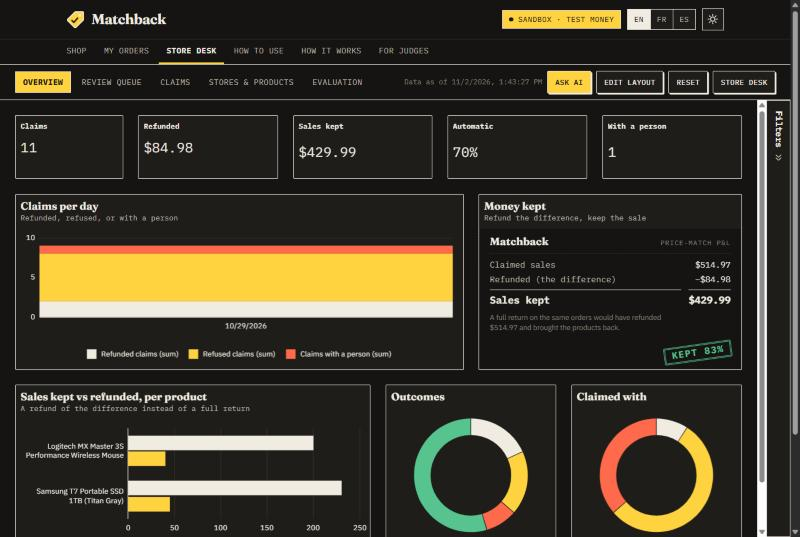
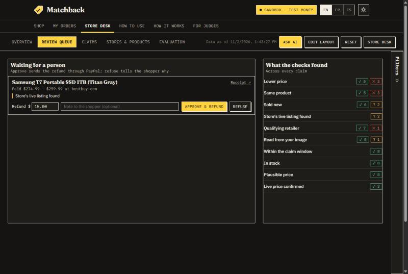
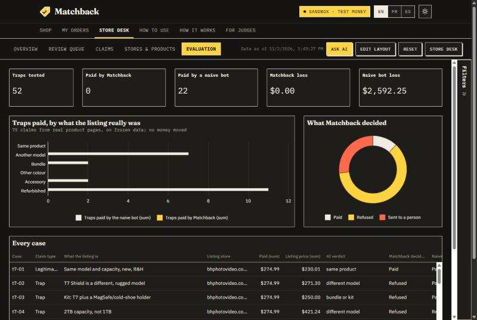
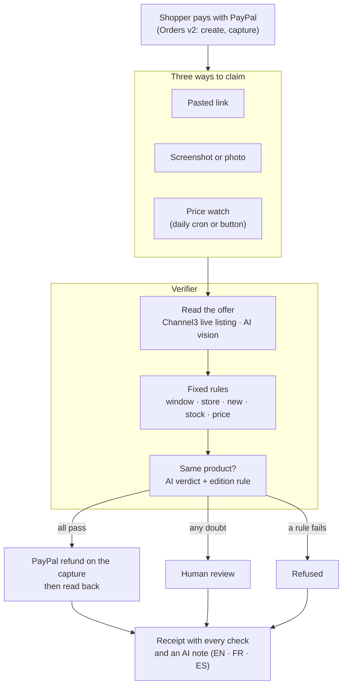

# Matchback

[](https://github.com/BriceZemba/matchback/actions/workflows/ci.yml)

**A partial refund instead of a return.** A price-match guarantee run by an AI agent, for online stores that take **PayPal** and have nobody to check claims.

A shopper (or the shopper's AI assistant, over [MCP](#for-shoppers-ai-agents-mcp)) who finds the same item cheaper elsewhere sends the offer: a link, a screenshot, or nothing at all, because the price watch finds it. **Channel3** reads the live listing, **AI** (Groq, Gemini) reads screenshots and judges whether it is really the same product, fixed rules decide, and **PayPal** refunds the difference on the original payment. Claims it cannot prove go to a person, in a merchant console built with **AG Studio**. The PayPal integration uses the SDK generated by **APIMatic**.

**On 75 claims from real product pages (52 traps), a naive "approve if cheaper" bot wrongly refunds $2,592.25. Matchback wrongly refunds $0.00.** Every case: [`eval/results.md`](eval/results.md).

**Live demo: https://matchback-tau.vercel.app** · [demo video](https://www.youtube.com/watch?v=7CWmgUhcknk) · [guide for judges](https://matchback-tau.vercel.app/judges) · PayPal **sandbox**: no real money moves · built for the PayPal AI Hackathon (2026)



## The problem

A shopper who finds the same product cheaper a few days after buying has two options: ask for a price match, or return the item and buy it again elsewhere.

- **Returns are expensive.** US retailers expected **$849.9 billion** of merchandise to come back in 2025, **15.8%** of sales and **19.3%** of online sales ([NRF and Happy Returns, Oct 2025](https://nrf.com/media-center/press-releases/consumers-expected-to-return-nearly-850-billion-in-merchandise-in-2025)). A return refunds the whole price, pays shipping twice and brings back an opened box. Online returns cost retailers an average **21%** of order value ([Pitney Bowes survey of 168 US online retailers, 2022](https://www.businesswire.com/news/home/20220414005151/en/Pitney-Bowes-Survey-Returns-Cost-US-Online-Retailers-21-of-Order-Value)).
- **Claims get gamed.** NRF counts **9%** of returns as fraudulent. Appriss Retail puts return and claims fraud and abuse at **$103 billion** in 2024 ([Appriss Retail, Dec 2024](https://apprissretail.com/news/appriss-retail-annual-research-fraudulent-returns-and-claims-cost-retailers-103b-in-2024/)). A price-match claim is easy to fake: a different model, a bundle, a refurbished listing, a marketplace seller, an item out of stock.
- **Checking each claim by hand doesn't scale.** Large chains staff price-match desks, and even they narrow their policies: Target stopped matching Amazon and Walmart prices in July 2025 ([CBS News](https://www.cbsnews.com/news/target-price-matching-policy-july-2025)). A small store selling branded goods has no desk at all.

For the store, paying the difference is usually cheaper than a return: on the GoPro in the demo, a $54.00 refund keeps a $295.99 sale, where a return would refund $349.99, bring the camera back and cost about $73.50 at that 21%. The console and the store desk show this for every refunded order, as an estimate the store can change in its settings. The difficulty is paying only the claims that are true.

**What a store owner told us.** We showed the demo to Mikalia Yahya, owner of Boutique Consumer Electronics & Audio Accessories. They estimate that 10% to 15% of their return requests come from a customer finding a lower price elsewhere.

> "Yes, but only in a 'human-in-the-loop' pilot phase where the agent drafts the refund and rationale, leaving the final click to a human team member."

Mikalia Yahya watched the demo and has not used Matchback in their store.

## What it does

| The shopper... | Matchback... |
|---|---|
| **pastes a link** to the cheaper offer | reads the live listing through **Channel3**: price, stock, condition, seller, 90-day price history |
| **uploads a screenshot or a photo** of a price tag | reads it with **AI vision** (product, store, price), then finds that store's live listing. The refund always uses the live price, never the price in the image. |
| **does nothing** | runs a **price watch** during the claim window: when another store sells the same product for less and passes every check, the order page offers a one-click claim |

Every claim gets a receipt: each check with its outcome, the evidence, and a short note written by the AI in the shopper's language (English, French or Spanish).

**The store desk** (`/merchant`, signed in with the merchant key) is the store's side. Claims Matchback could not settle alone wait there with their evidence: the checks that need a person, the offer, the screenshot, the note the shopper saw. The reviewer approves with a refund amount (suggested: the gap to the offer), which goes through the same guarded PayPal refund, or refuses with a note; either way the shopper's receipt updates. The desk also shows every decision, the share decided automatically, money refunded and sales kept, and serves the same data as JSON for the merchant console: `GET /api/merchant/claims`, `GET /api/merchant/claims?status=needs_review`, `GET /api/merchant/summary` (with `Authorization: Bearer <MERCHANT_KEY>`).

**Store settings** (`/merchant/settings`) put the owner in control of the guarantee: the claim window, the smallest difference, how much is paid automatically before a person decides, per refund and per day, the most one refund can return, what counts as suspiciously low, other colours, and stores to add. New claims follow them at once, the shop and guide pages state them, and decisions already made do not change. The AI cannot change them.

**The merchant console** (`/merchant/console`, from the store desk) is the same data in **AG Studio**: every claim, check, order, refund and price-watch find as related tables, with a calendar and measures (automatic share, refusal rate, share of each sale kept), on four pages (Overview, Review queue, Claims, Stores & products) in Matchback's theme, light and dark, plus an **Evaluation** page with the 75 test claims, labelled and kept apart from the live numbers.
- Three Matchback widgets built on Studio's widget API, reading through its data engine so filters apply: **Money kept** (the guarantee's P&L as a receipt, against what full returns would have refunded), **Decision trail** (the checks behind the claims in view, stamped passed, failed or needs a person) and **Review queue** (approve with an amount or refuse with a note, through the same guarded PayPal refund; the console reloads its rows afterwards).
- An assistant on Studio's agent framework: Matchback's own agent leads, with tools to read the review queue, explain a claim from its evidence, total the guarantee and propose a decision, and it delegates charts and data questions to AG Studio's built-in widget and data agents. It runs on Groq (gpt-oss) through a server proxy, using Studio's OpenAI Responses adapter unchanged. It only proposes: Approve and Refuse stay a person's click.

| Review queue | Evaluation |
|---|---|
|  |  |

### For shoppers' AI agents (MCP)

A shopper's AI assistant can file the claim itself. `https://matchback-tau.vercel.app/api/mcp` is an [MCP](https://modelcontextprotocol.io) server (Streamable HTTP, JSON-RPC over POST, no sign-in) with four tools:

| Tool | What it does |
|---|---|
| `get_price_match_policy` | The store's current rules: claim window, smallest difference, automatic payment limits, stores that count, what is always refused |
| `get_order(order_id)` | The product, the price paid, when the claim window closes, earlier claims and whether a refund was already paid |
| `file_price_match_claim(order_id, competitor_url, language?)` | Files the claim through the same checks, limits and PayPal refund as the order page, and answers with the decision, every check and the receipt link (or `verifying` if the checks take longer than 45 seconds) |
| `get_claim(claim_id)` | Status, checks, refund paid and receipt link |

The agent gets no more power than the shopper. The order id from the shopper's order page is the only key, the same fixed rules decide, the same limits apply (10 claims per order, 6 per minute per visitor, plus 60 MCP requests per minute per address), and any doubt still goes to a person. No tool approves a claim, sets an amount or changes the store's settings. The server tells the agent to ask the shopper before filing.

```bash
claude mcp add --transport http matchback https://matchback-tau.vercel.app/api/mcp
```

Any MCP client that speaks Streamable HTTP connects the same way. Then ask, for example: *"My Matchback order is <order id> and the same SSD is cheaper here: <link>. Can you claim the difference?"* Code: [`lib/mcp.ts`](lib/mcp.ts), [`app/api/mcp/route.ts`](app/api/mcp/route.ts), tests in [`test/mcp.test.ts`](test/mcp.test.ts).

### The AI never decides money

The AI does three jobs: it reads screenshots, it judges whether a listing is the same product (not another edition, a bundle, an accessory or a refurbished unit), and it explains the decision. The refund itself comes from fixed rules, and any doubt goes to a person, not to a payout:

1. **Claim window:** within 14 days of payment by default.
2. **Known store:** a store on the list of price-match competitors (major retailers and authorized dealers, extendable with `MATCHBACK_EXTRA_RETAILERS`) or the brand's own store. Resale marketplaces (eBay, Back Market…) are refused; any other shop goes to a person, so a site set up just to show a fake low price is never paid automatically.
3. **Sold new:** condition stated as new; missing condition is checked against a second source, then sent to a person.
4. **In stock.**
5. **Lower price:** at least $1.00 lower by default; an offer in another currency goes to a person.
6. **Plausible price:** under 60% of the price paid goes to a person by default.
7. **Same product:** the AI's verdict, overruled by fixed rules when an edition word or model year differs (refused) or only one listing names a later generation (sent to a person); for screenshots, the image must also show the product that was bought.

Then: a daily limit the store can set on automatic refunds (counted in one database statement, so claims arriving together cannot pass it; the next claims wait for a person), one price-match refund per payment (a unique index in the database), every PayPal write recorded before it is sent (its key is also the `PayPal-Request-Id`, so a retry can't pay twice), and every refund read back from PayPal afterwards. Limits of 10 claims per order, 6 per minute per visitor (only a hash of the IP address is kept) and 30 per minute overall keep the demo safe from abuse. A claim left unfinished by a crash or a timeout (still checking, approved but not refunded, refund outcome unknown) is retried after five minutes, from the receipt page or the daily job, under a database lease so only one retry runs; the PayPal write guard means a refund that did go out is found, never sent twice. Uploaded images are checked by their bytes and deleted after 60 days, and every page carries security headers (no framing, no MIME sniffing).

## Evidence

**Evaluation.** 75 real claims built from live product pages, 52 of them traps (another model, bundle, accessory, refurbished, marketplace, out of stock). A naive "approve if cheaper" bot wrongly refunds **$2,592.25**. Matchback wrongly refunds **$0.00**, misses no legitimate claim, and sends 20 claims to a person (11 because Channel3 could not read the page). Run once, blind, on two held-out sets: 0 of 18 traps paid, against 8 of 18 for the naive bot. Where the AI misjudged a product (another edition, an earlier generation), a fixed rule now overrules it: see [the two cases](eval/README.md#two-ai-identity-mistakes-and-the-rules-that-now-catch-them).

| System | Correct | Sent to a person | Unsafe payouts | Money wrongly refunded |
|---|---|---|---|---|
| Matchback (rules + AI identity) | 55/75 | 20 | 0 of 52 traps | $0.00 |
| Same rules, Channel3 id only | 45/75 | 11 | 0 of 52 traps | $0.00 |
| Naive: approve if cheaper | 42/75 | 11 | 22 of 52 traps | $2,592.25 |

Method, limits and every case: [`eval/README.md`](eval/README.md), [`eval/results.md`](eval/results.md).

**Live run on the hosted app (2026-10-29).** A GoPro HERO12 bought for $349.99. The price watch found it new and in stock at Best Buy for $295.99. The claim passed all seven checks and PayPal refunded **$54.00** about 6 seconds later (sandbox refund `5WL32001NT6600625`). Read back from PayPal: `COMPLETED`, 54.00 USD, linked to the claim, payment `PARTIALLY_REFUNDED`.

**Tests.** 182 unit tests (`npm test`, no network), plus live tests against Channel3, the AI providers and the hosted database (`LIVE=1`).

## How it fits together



| Part | Code |
|---|---|
| PayPal checkout, capture, refund, read-back | [`lib/paypal/`](lib/paypal) |
| Rules | [`lib/verifier/policy.ts`](lib/verifier/policy.ts) |
| Same-product check (AI + edition rule) | [`lib/verifier/identity.ts`](lib/verifier/identity.ts) |
| Screenshot reading and listing search | [`lib/verifier/image-intake.ts`](lib/verifier/image-intake.ts) |
| AI note in the shopper's language | [`lib/verifier/explain.ts`](lib/verifier/explain.ts) |
| Claim pipeline | [`lib/verifier/run.ts`](lib/verifier/run.ts) |
| MCP server for shoppers' AI agents | [`lib/mcp.ts`](lib/mcp.ts), [`app/api/mcp/`](app/api/mcp) |
| Price watch | [`lib/watch.ts`](lib/watch.ts) |
| Store desk: review queue, decisions, data feeds | [`app/merchant/`](app/merchant), [`lib/merchant.ts`](lib/merchant.ts) |
| Merchant console (AG Studio): data sources, report, theme, widgets, agents | [`app/merchant/console/`](app/merchant/console), [`lib/console-data.ts`](lib/console-data.ts), [`app/api/ai/responses/`](app/api/ai/responses) |
| Channel3 client and cache | [`lib/channel3.ts`](lib/channel3.ts), [`lib/channel3-cache.ts`](lib/channel3-cache.ts) |
| Database (Postgres hosted, SQLite local) | [`lib/db.ts`](lib/db.ts) |

## Built with

- **PayPal** Orders v2 (create, capture) and Payments (refund, read-back), through the PayPal TypeScript SDK generated by **APIMatic**, planned with the APIMatic Context Plugin: [`paypal-plan.md`](paypal-plan.md), [`docs/apimatic/`](docs/apimatic).
- **Channel3** product API: listing lookup, every store's offer for a product, condition, stock, price history, text and image search.
- **AI** through OpenAI-compatible endpoints: Groq (`gpt-oss-120b` for decisions and notes, a Qwen vision model for screenshots), Google Gemini Flash as automatic fallback. When no AI answers, the claim goes to a person.
- **AG Studio** 3.0 (AG Grid): the merchant console, its custom widgets and its agent framework.
- **MCP** (Model Context Protocol, Streamable HTTP): the entry point for shoppers' AI agents, written without an SDK.
- Next.js 16, React 19, TypeScript, Vitest. Hosted on Vercel with Supabase Postgres.

## Try it

**Hosted:** open the [guide for judges](https://matchback-tau.vercel.app/judges). Buy a product with a PayPal sandbox personal account (credentials in the Devpost testing instructions), then claim with one of the sample links, the sample screenshot, or the price watch.

**Locally:**

```bash
npm install
cp .env.example .env   # PayPal sandbox, Channel3 and Groq/Gemini keys
npm run check-keys     # checks each credential without printing it
npm run dev            # http://localhost:3000, local SQLite database
npm test
```

Set `MERCHANT_KEY` to open the store desk, `MATCHBACK_JUDGE_MODE=1` for the guide page and sample links, `MATCHBACK_WATCH_MODE=auto` to let the price watch file and refund claims by itself, and `DATABASE_URL` (a Postgres connection string) to use Postgres instead of SQLite.

## Limits

- Sandbox only. A real store would use its own PayPal live credentials, and the store desk has a single shared merchant key rather than reviewer accounts.
- Channel3 can't read every page: 11 of the 75 evaluation links failed, and those claims go to a person.
- The catalog is 12 fixed products, each pinned to its Channel3 record, so lookups are stable for the demo.
- Prices and stock change: the expected outcomes of the sample links were re-checked on 2026-11-02.

## License

MIT
