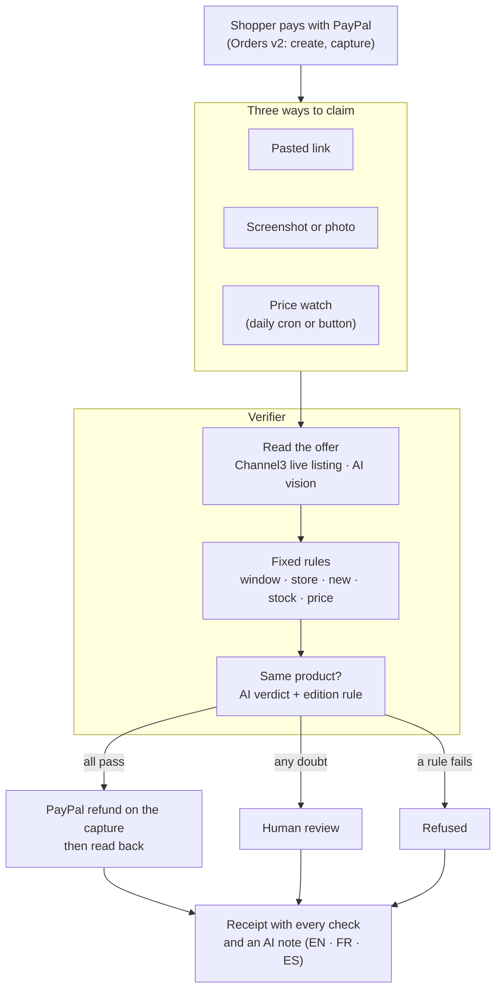

# Matchback

**A partial refund instead of a return.**

Matchback lets an online store offer a price-match guarantee without a price-match desk and without paying fake claims. A shopper who paid with PayPal and finds the same item cheaper elsewhere sends the offer (a link, a screenshot, or nothing at all: the price watch finds it). Matchback checks the offer against live store data, fixed rules decide, and PayPal refunds the difference on the original payment. The customer keeps the item, and the store keeps the sale.

**Live demo: https://matchback-tau.vercel.app** · guide for judges: [/judges](https://matchback-tau.vercel.app/judges)

> Built for the PayPal AI Hackathon (2026). Runs on the PayPal **sandbox**: no real money moves.

<p align="center"></p>

## The problem

A shopper who finds the same product cheaper a few days after buying has two options: ask for a price match, or return the item and buy it again elsewhere.

- **Returns are expensive.** US retailers expected **$849.9 billion** of merchandise to come back in 2025, **15.8%** of sales and **19.3%** of online sales ([NRF and Happy Returns, Oct 2025](https://nrf.com/media-center/press-releases/consumers-expected-to-return-nearly-850-billion-in-merchandise-in-2025)). A return refunds the whole price, pays shipping twice and brings back an opened box.
- **Claims get gamed.** NRF counts **9%** of returns as fraudulent. Appriss Retail puts return and claims fraud and abuse at **$103 billion** in 2024 ([Appriss Retail, Dec 2024](https://apprissretail.com/news/appriss-retail-annual-research-fraudulent-returns-and-claims-cost-retailers-103b-in-2024/)). A price-match claim is easy to fake: a different model, a bundle, a refurbished listing, a marketplace seller, an item out of stock.
- **Checking each claim by hand doesn't scale.** Large chains staff price-match desks, and even they narrow their policies: Target stopped matching Amazon and Walmart prices in July 2025 ([CBS News](https://www.cbsnews.com/news/target-price-matching-policy-july-2025)). A small store selling branded goods has no desk at all.

For the store, paying the difference is usually cheaper than a return: on the GoPro in the demo, a $54.00 refund keeps a $295.99 sale, where a return would refund $349.99 and bring the camera back. The difficulty is paying only the claims that are true.

## What it does

| The shopper... | Matchback... |
|---|---|
| **pastes a link** to the cheaper offer | reads the live listing through **Channel3**: price, stock, condition, seller, 90-day price history |
| **uploads a screenshot or a photo** of a price tag | reads it with **AI vision** (product, store, price), then finds that store's live listing. The refund always uses the live price, never the price in the image. |
| **does nothing** | runs a **price watch** during the claim window: when another store sells the same product for less and passes every check, the order page offers a one-click claim |

Every claim gets a receipt: each check with its outcome, the evidence, and a short note written by the AI in the shopper's language (English, French or Spanish).

**The store desk** (`/merchant`, signed in with the merchant key) is the store's side. Claims Matchback could not settle alone wait there with their evidence: the checks that need a person, the offer, the screenshot, the note the shopper saw. The reviewer approves with a refund amount (suggested: the gap to the offer), which goes through the same guarded PayPal refund, or refuses with a note; either way the shopper's receipt updates. The desk also shows every decision, the share decided automatically, money refunded and sales kept, and serves the same data as JSON for the merchant console: `GET /api/merchant/claims`, `GET /api/merchant/claims?status=needs_review`, `GET /api/merchant/summary` (with `Authorization: Bearer <MERCHANT_KEY>`).

### The AI never decides money

The AI does three jobs: it reads screenshots, it judges whether a listing is the same product (not another edition, a bundle, an accessory or a refurbished unit), and it explains the decision. The refund itself comes from fixed rules, and any doubt goes to a person, not to a payout:

1. **Claim window:** within 14 days of payment.
2. **Real store:** resale marketplaces (eBay, Back Market…) are refused.
3. **Sold new:** condition stated as new; missing condition is checked against a second source, then sent to a person.
4. **In stock.**
5. **Lower price:** at least $1.00 lower; an offer in another currency goes to a person.
6. **Plausible price:** under 60% of the price paid goes to a person.
7. **Same product:** the AI's verdict, with a fixed rule that refuses a mismatched edition, and for screenshots a check that the image shows the product that was bought.

Then: one price-match refund per payment (a unique index in the database), every PayPal write recorded before it is sent (its key is also the `PayPal-Request-Id`, so a retry can't pay twice), and every refund read back from PayPal afterwards. Limits of 10 claims per order and 20 per minute keep the demo safe from abuse.

## Evidence

**Evaluation.** 49 real claims built from live product pages, 33 of them traps (another model, bundle, accessory, refurbished, marketplace, out of stock). A naive "approve if cheaper" bot wrongly refunds **$1,751.86**. Matchback wrongly refunds **$0.00**, and sends 14 claims to a person (7 because Channel3 could not read the page).

| System | Correct | Sent to a person | Unsafe payouts | Money wrongly refunded |
|---|---|---|---|---|
| Matchback (rules + AI identity) | 34/49 | 14 | 0 of 33 traps | $0.00 |
| Same rules, Channel3 id only | 30/49 | 7 | 0 of 33 traps | $0.00 |
| Naive: approve if cheaper | 27/49 | 7 | 15 of 33 traps | $1,751.86 |

Method, limits and every case: [`eval/README.md`](eval/README.md), [`eval/results.md`](eval/results.md).

**Live run on the hosted app (2026-10-29).** A GoPro HERO12 bought for $349.99. The price watch found it new and in stock at Best Buy for $295.99. The claim passed all seven checks and PayPal refunded **$54.00** about 6 seconds later (sandbox refund `5WL32001NT6600625`). Read back from PayPal: `COMPLETED`, 54.00 USD, linked to the claim, payment `PARTIALLY_REFUNDED`.

**Tests.** 94 unit tests (`npm test`, no network), plus live tests against Channel3, the AI providers and the hosted database (`LIVE=1`).

## How it fits together



| Part | Code |
|---|---|
| PayPal checkout, capture, refund, read-back | [`lib/paypal/`](lib/paypal) |
| Rules | [`lib/verifier/policy.ts`](lib/verifier/policy.ts) |
| Same-product check (AI + edition rule) | [`lib/verifier/identity.ts`](lib/verifier/identity.ts) |
| Screenshot reading and listing search | [`lib/verifier/image-intake.ts`](lib/verifier/image-intake.ts) |
| AI note in the shopper's language | [`lib/verifier/explain.ts`](lib/verifier/explain.ts) |
| Claim pipeline | [`lib/verifier/run.ts`](lib/verifier/run.ts) |
| Price watch | [`lib/watch.ts`](lib/watch.ts) |
| Store desk: review queue, decisions, data feeds | [`app/merchant/`](app/merchant), [`lib/merchant.ts`](lib/merchant.ts) |
| Channel3 client and cache | [`lib/channel3.ts`](lib/channel3.ts), [`lib/channel3-cache.ts`](lib/channel3-cache.ts) |
| Database (Postgres hosted, SQLite local) | [`lib/db.ts`](lib/db.ts) |

## Built with

- **PayPal** Orders v2 (create, capture) and Payments (refund, read-back), through the PayPal TypeScript SDK generated by **APIMatic**, planned with the APIMatic Context Plugin: [`paypal-plan.md`](paypal-plan.md), [`docs/apimatic/`](docs/apimatic).
- **Channel3** product API: listing lookup, every store's offer for a product, condition, stock, price history, text and image search.
- **AI** through OpenAI-compatible endpoints: Groq (`gpt-oss-120b` for decisions and notes, a Qwen vision model for screenshots), Google Gemini Flash as automatic fallback. When no AI answers, the claim goes to a person.
- Next.js 16, React 19, TypeScript, Vitest. Hosted on Vercel with Supabase Postgres.

## Try it

**Hosted:** open the [guide for judges](https://matchback-tau.vercel.app/judges). Buy a product with a PayPal sandbox personal account (credentials in the Devpost testing instructions), then claim with one of the sample links, the sample screenshot, or the price watch.

**Locally:**

```bash
npm install
cp .env.example .env   # PayPal sandbox, Channel3 and Groq/Gemini keys
npm run check-keys     # checks each credential without printing it
npm run dev            # http://localhost:3000, local SQLite database
npm test
```

Set `MERCHANT_KEY` to open the store desk, `MATCHBACK_JUDGE_MODE=1` for the guide page and sample links, `MATCHBACK_WATCH_MODE=auto` to let the price watch file and refund claims by itself, and `DATABASE_URL` (a Postgres connection string) to use Postgres instead of SQLite.

## Limits

- Sandbox only. A real store would use its own PayPal live credentials, and the store desk has a single shared merchant key rather than reviewer accounts.
- Channel3 can't read every page: 7 of the 49 evaluation links failed, and those claims go to a person.
- The catalog is 12 fixed products, each pinned to its Channel3 record, so lookups are stable for the demo.
- Prices and stock change: the expected outcomes of the sample links were recorded on 2026-10-29.

## License

MIT
